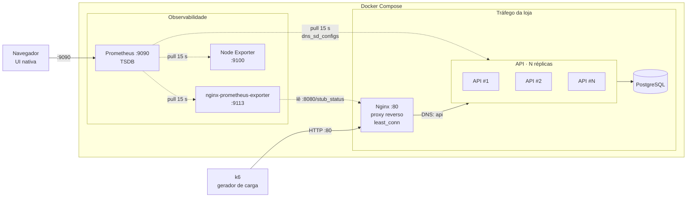
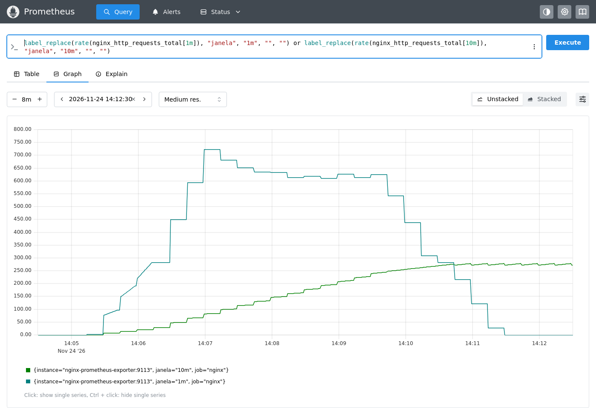
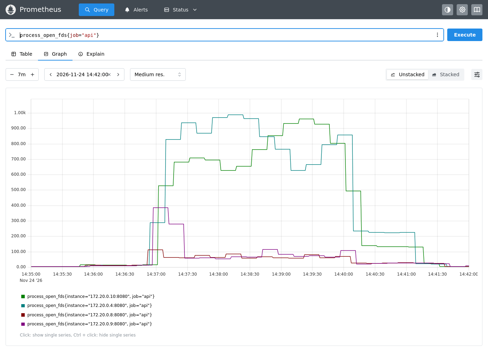
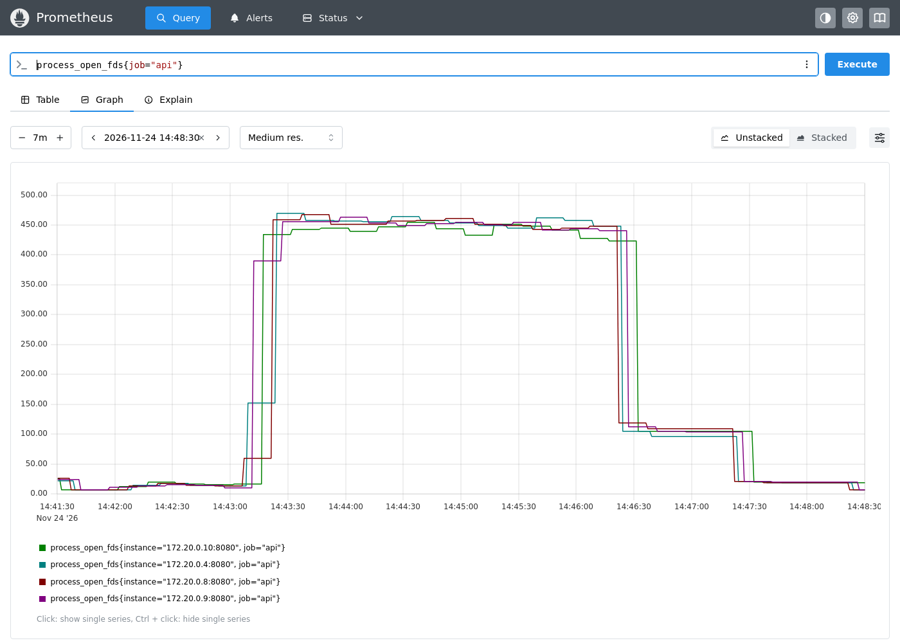

<div align="center">

# 🛒 Black Friday Scaling

**Observabilidade com Prometheus e escalonamento de uma loja virtual sob o pico da Black Friday**

Trabalho da **P2 de Redes de Computadores**: *Prometheus, 13. A Teia de Métricas (Web Scraping Contínuo)*

<br>


</div>

---

## 📋 O problema proposto

> **Prometheus — 13. A Teia de Métricas (Web Scraping Contínuo)**
>
> **Problema:**
> Um servidor web de uma plataforma de E-commerce experimenta picos sazonais
> (Black Friday). A equipe de DevOps precisa raspar métricas ativas do servidor
> Nginx (requisições por segundo, tempo de resposta) para escalar os contêineres
> a tempo.
>
> **Solução e Fundamentação:**
> Implantação do Node Exporter no servidor de destino e configuração do arquivo
> `prometheus.yml` para varrer o endpoint de métricas no modelo de coleta ativa
> (Pull Model). Entendimento profundo de como bancos de dados de séries temporais
> (TSDB) armazenam pares de chaves-valores atrelados a timestamps.
>
> **Resultados Esperados:**
> Configuração correta do Job de Scraping. Execução de expressões matemáticas
> básicas em PromQL (Prometheus Query Language) na interface nativa para calcular
> a taxa de crescimento de acessos HTTP nos últimos 10 minutos (`rate()`).

## ✅ Como o projeto responde ao enunciado

| Requisito | Como foi atendido | Onde |
|---|---|---|
| Servidor web de e-commerce | Loja mínima em Bun + Fastify + PostgreSQL: catálogo e compra | [`server/`](server/) · [seção 1](docs/01-aplicacao.md) |
| Raspar métricas ativas do **Nginx** | `stub_status` numa porta interna + `nginx-prometheus-exporter` | [`nginx/`](nginx/) · [seção 2](docs/02-nginx.md) |
| **Requisições por segundo** | `rate(nginx_http_requests_total[1m])` | [seção 3](docs/03-prometheus.md) |
| **Tempo de resposta** | O `stub_status` não fornece latência, então a API expõe um histograma por rota em `/metrics` | [seção 4](docs/04-metricas-da-aplicacao.md) |
| **Node Exporter** no servidor | Contêiner `node-exporter`, com a análise do que ele enxerga num contêiner | [seção 3.5](docs/03-prometheus.md) |
| `prometheus.yml` no **modelo pull** | Escrito à mão, com 4 jobs e intervalo de coleta derivado (15 s) | [`prometheus/prometheus.yml`](prometheus/prometheus.yml) |
| Fundamentação da **TSDB** | Séries = nome + labels, head block, WAL, blocos de 2 h, compressão Gorilla, com números medidos | [seção 3.7](docs/03-prometheus.md) |
| `rate()` dos últimos **10 minutos** na UI nativa | Executado durante a Black Friday simulada, comparado com a janela de 1 min | [seção 5](docs/05-black-friday-1-replica.md) |
| **Escalar os contêineres a tempo** | Testes com 1 e 4 réplicas, round-robin × `least_conn`, cenário de escalonamento planejado | [seções 6](docs/06-escalando-4-replicas.md) e [7](docs/07-cenario-escalonamento-planejado.md) |

**Além do enunciado:** testes de carga com k6 (fumaça, ruptura e Black Friday), números
derivados de medições e da lei de Little, descoberta de serviço por DNS e, como próximo
passo, autoescalonamento com KEDA.

## 🏗️ Arquitetura



Linhas contínuas são o tráfego da loja; linhas tracejadas são a coleta de métricas.

Três camadas de observação, cada uma respondendo uma pergunta:

| Camada | Fonte | Pergunta | Método |
|---|---|---|---|
| Borda | Nginx (`stub_status`) | Quanto tráfego está chegando? | RED |
| Aplicação | API (`/metrics`) | Como a API está atendendo? | RED |
| Infraestrutura | Node Exporter | A máquina aguenta? | USE |

## 📊 Principais resultados

Mesma Black Friday simulada (pico de **2.826 req/s**, 3× a capacidade estimada de uma
réplica), mudando o número de réplicas e o balanceamento:

| | 1 réplica | 4 réplicas, round-robin | 4 réplicas, `least_conn` |
|---|---|---|---|
| Vazão no pico | 642 req/s | 1.685–2.173 req/s | 1.728 req/s |
| Visitantes descartados | 410.441 | 122.671–211.686 | 202.872 |
| Mediana da duração | 1,9 s | 7,5–55 ms | 709 ms |
| p95 navegação | 2,36 s | 1,88–2,26 s | **0,97 s** |
| Pior caso | 5,26 s | 4,83–5,49 s | **2,50 s** |
| Réplicas saturadas | 1 de 1 | 1–2 de 4 | 4 de 4 |

- **Escalar aumentou a capacidade** de 2,6 a 3,4 vezes, mas o crescimento não foi linear:
  as réplicas dividem a mesma CPU e o mesmo banco.
- **O round-robin gerou réplicas presas na fila**: com a mesma carga, algumas réplicas
  ficaram logo abaixo do limite e outras passaram dele e não voltaram (teoria de filas,
  ρ ≈ 1).
- **O `least_conn` dividiu a fila por igual** e cortou o pior caso pela metade, mas não
  aumentou a vazão. **O balanceador não cria capacidade: só decide quem espera.**
- **A rede não foi o gargalo**: quase todo o tempo de cada requisição foi espera pelo
  primeiro byte; conexão, envio e recebimento somaram frações de milissegundo.

<div align="center">

**`rate()` de 1 minuto × 10 minutos durante o pico** (consulta do enunciado na UI nativa)



**Conexões abertas por réplica: round-robin (esq.) × `least_conn` (dir.)**




</div>

## 🧰 Tecnologias

| Componente | Tecnologia | Versão | Porta |
|---|---|---|---|
| Runtime / framework | Bun + Fastify | 1.4.5 / 5.12.8 | 8080 (interna) |
| Banco de dados | PostgreSQL | 17 | 5432 (interna) |
| Proxy reverso / balanceador | Nginx | 1.31.9 | **80** |
| Exporter do Nginx | `nginx/nginx-prometheus-exporter` | 1.5.3 | 9113 (interna) |
| Métricas da máquina | `prom/node-exporter` | 1.13.1 | 9100 (interna) |
| Coleta e TSDB | `prom/prometheus` | 3.16.0 | **9090** |
| Instrumentação da API | `prom-client` | 15.1.3 | `/metrics` |
| Testes de carga | Grafana k6 | 2.4.0 | 5665 (dashboard) |

## 📁 Estrutura

```
.
├── server/                 # API da loja (Bun + Fastify)
│   ├── src/config/         #   servidor, variáveis de ambiente e métricas (metrics.ts)
│   ├── src/controller/     #   validação e códigos HTTP
│   ├── src/model/          #   consultas SQL
│   └── src/db/migrations/  #   tabelas e 64 produtos de exemplo
├── nginx/                  # configuração do Nginx (upstream, proxy, stub_status)
├── prometheus/             # prometheus.yml escrito à mão
├── k6/                     # testes de carga
│   └── src/
│       ├── lib/capacity.ts #   capacidade medida, SLO e lei de Little
│       └── tests/          #   smoke, breakpoint e black-friday
├── docs/                   # seções do artigo e figuras
└── docker-compose.yml
```

## 🚀 Como executar

**Pré-requisitos:** Docker com Compose, [k6](https://grafana.com/docs/k6/latest/set-up/install-k6/)
e [Bun](https://bun.sh) (só para editar o código e os testes localmente).

```bash
docker compose up -d --build
```

| Endereço | O que é |
|---|---|
| http://localhost/products | catálogo da loja, pelo Nginx |
| http://localhost:9090 | UI nativa do Prometheus |
| http://localhost:9090/targets | estado dos alvos de coleta |

Escalar a API (o Nginx e o Prometheus descobrem as réplicas novas sozinhos, em até 10 s):

```bash
docker compose up -d --scale api=4
```

### Testes de carga

```bash
cd k6
```

```bash
k6 run src/tests/smoke.ts
```

```bash
k6 run -e TARGET=read src/tests/breakpoint.ts
```

```bash
K6_WEB_DASHBOARD=true K6_WEB_DASHBOARD_EXPORT=black-friday.html k6 run src/tests/black-friday.ts
```

| Teste | Pergunta que responde |
|---|---|
| `smoke` | O sistema funciona com carga mínima? |
| `breakpoint` | Quantas req/s **uma réplica** aguenta antes de violar o SLO? (`TARGET=read` ou `buy`) |
| `black-friday` | O que acontece quando o tráfego salta para 3× a capacidade de repente? (`-e PEAK=5` muda o pico) |

## 🔎 Consultas PromQL

```promql
# Consulta do enunciado: taxa de acessos HTTP nos últimos 10 minutos
rate(nginx_http_requests_total[10m])

# Requisições por segundo de cada réplica da API
sum by (instance) (rate(http_request_duration_seconds_count{job="api"}[1m]))

# p95 da latência por rota, somando os buckets de todas as réplicas
histogram_quantile(0.95, sum by (le, route) (rate(http_request_duration_seconds_bucket{job="api"}[1m])))

# % de requisições dentro do SLO de 500 ms
100 * sum(rate(http_request_duration_seconds_bucket{job="api", le="0.5"}[1m]))
    / sum(rate(http_request_duration_seconds_count{job="api"}[1m]))

# CPU de cada réplica (limite: 0,5 núcleo)
rate(process_cpu_seconds_total{job="api"}[1m])
```

## 📚 Documentação

| Seção | Conteúdo |
|---|---|
| [1. A aplicação](docs/01-aplicacao.md) | API, modelo de dados, pool de conexões, limites do contêiner |
| [2. Nginx](docs/02-nginx.md) | Proxy reverso, balanceamento, descoberta por DNS, `stub_status` |
| [3. Prometheus](docs/03-prometheus.md) | Modelo pull, exporters, Node Exporter, `prometheus.yml`, **TSDB** |
| [4. Métricas da aplicação](docs/04-metricas-da-aplicacao.md) | Histograma, buckets, agregação entre réplicas |
| [5. Black Friday com 1 réplica](docs/05-black-friday-1-replica.md) | Resultados por camada, `rate()` de 1 min × 10 min, decomposição do tempo |
| [6. Escalando para 4 réplicas](docs/06-escalando-4-replicas.md) | Round-robin × `least_conn`, teoria de filas |
| [7. Escalonamento planejado](docs/07-cenario-escalonamento-planejado.md) | Planejamento de capacidade e intervenção manual guiada pelo Prometheus |

## 🗺️ Próximos passos

- [x] Loja, Nginx, exporters e Prometheus no Docker Compose
- [x] Testes de carga e Black Friday com 1 e 4 réplicas
- [x] Cenário 1: escalonamento planejado
- [ ] Cenário 2: autoescalonamento com **KEDA** no Kubernetes local (k3s via k3d), disparado por PromQL
- [ ] Gerador de carga em contêiner, na mesma rede do sistema

## ⚠️ Limitações

- O gerador de carga roda na mesma máquina do sistema e disputa CPU com ele.
- Todas as réplicas compartilham um único PostgreSQL: escalar a API não escala o banco.
- A loja não tem controle de estoque nem transações; problemas como venda acima do
  estoque (*overselling*) ficam fora do escopo.
- Cada configuração de teste foi executada uma vez; repetições dariam margens de erro.
