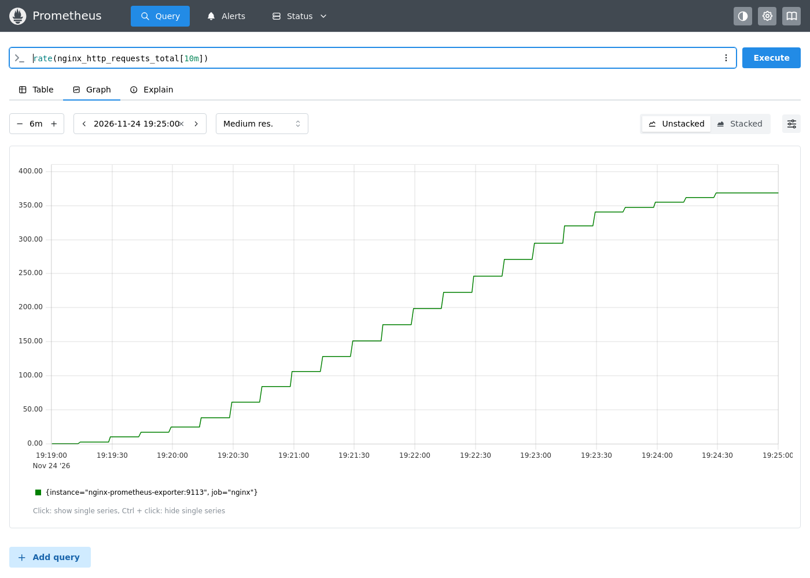
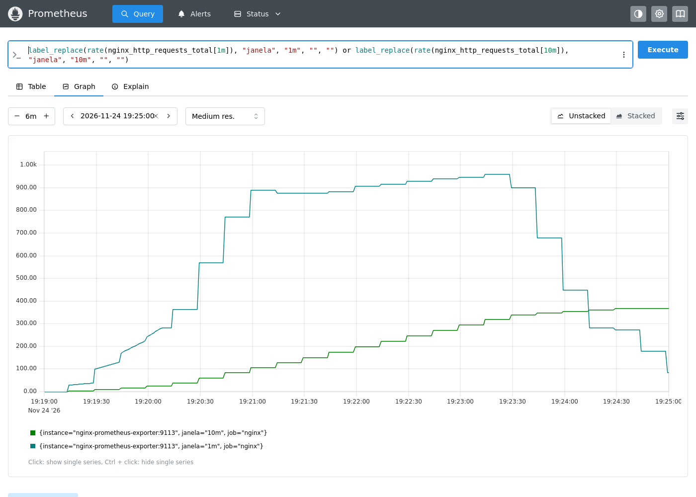
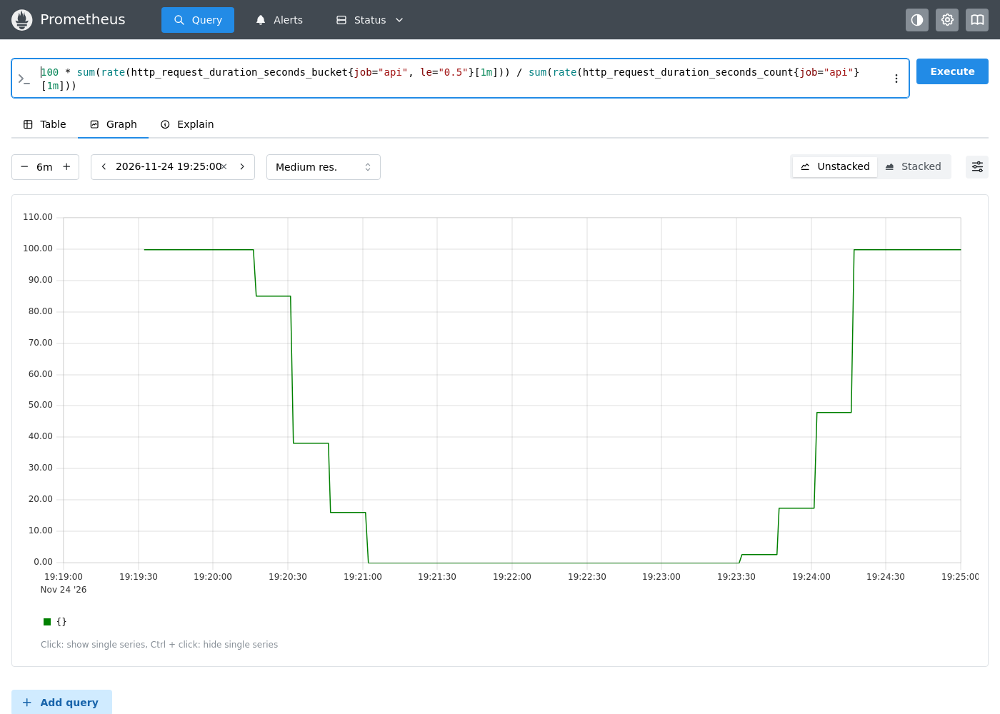
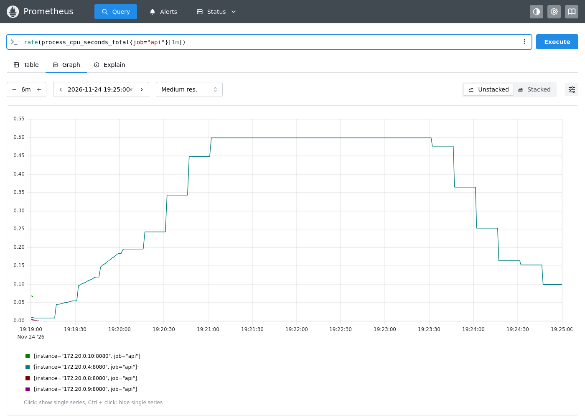
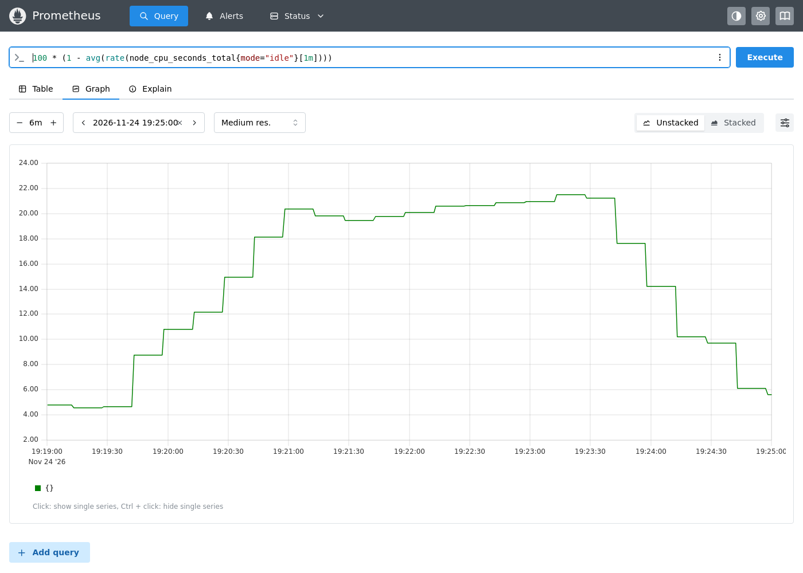
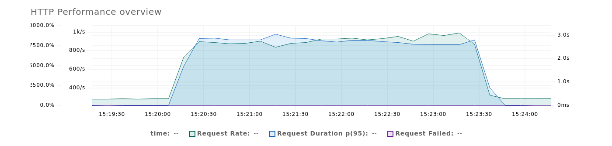
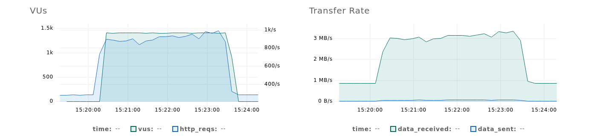
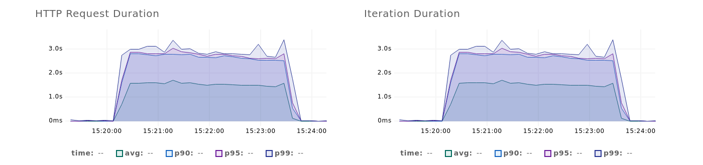
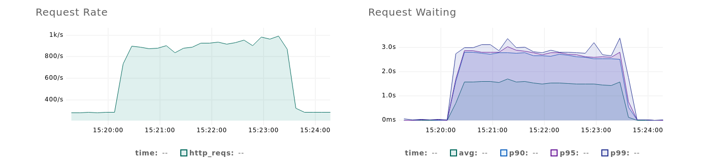
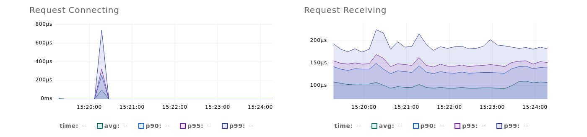

# 5. Teste de Black Friday com uma réplica

> Rascunho de documentação do processo, para virar seção do artigo.
> Valores: mediana de três execuções [mínimo–máximo]. Ambiente e procedimento na
> seção 8. Figuras e séries temporais: primeira execução, 19:19:06–19:24:28 UTC de
> 2026-11-24.

## 5.1 Objetivo

Observar, pelas métricas coletadas pelo Prometheus, o comportamento do sistema
quando o tráfego salta de repente para muito acima da capacidade de **uma
única réplica** da API. Este é o cenário de referência para os testes com mais
réplicas.

## 5.2 Desenho do teste

Arquivo `k6/src/tests/black-friday.ts`. As taxas são múltiplos da capacidade
medida de uma réplica, calculada em `k6/src/lib/capacity.ts`:

| Grandeza | Valor | Origem |
|---|---|---|
| Capacidade de leitura (`GET /products`) | 1.100 req/s | medida em 2026-11-23, com 50 VUs |
| Capacidade de compra (`POST /orders`) | 600 req/s | medida em 2026-11-23, com 50 VUs |
| Mistura de tráfego | 80 % navegação, 20 % compra | premissa |
| Capacidade para o tráfego misto | **942 req/s** | 1 ÷ (0,8 ÷ 1100 + 0,2 ÷ 600) |
| Tráfego normal | 283 req/s | 30 % da capacidade |
| Pico | **2.826 req/s** | 3× a capacidade de uma réplica |

| Fase | Duração | Taxa |
|---|---|---|
| véspera | 1 min | 283 req/s |
| abertura da promoção | 10 s | sobe até 2.826 req/s |
| pico sustentado | 3 min | 2.826 req/s |
| fim da corrida | 10 s | volta a 283 req/s |
| recuperação | 1 min | 283 req/s |

O teste usa o modelo **aberto** do k6 (`ramping-arrival-rate`): a taxa de chegada
não depende de o servidor responder. O número máximo de usuários virtuais vem da
lei de Little (VUs = taxa × tempo de resposta) com o SLO de 0,5 s: 1.131 VUs para
navegação e 283 para compra. Com todos ocupados, o k6 conta as requisições que não
conseguiu iniciar como `dropped_iterations`, aqui chamadas de visitantes
descartados.

## 5.3 Resultados no cliente (k6)

| Métrica | Valor | SLO |
|---|---|---|
| Requisições atendidas | 214.743 [211.745–215.781] | |
| Requisições com erro | 0 | < 1 % ✓ |
| Mediana da duração | 1,39 s [1,38–1,40] | |
| p95 navegação | 1,55 s [1,52–1,57] | < 0,5 s ✗ |
| p95 compra | 3,06 s [2,99–3,07] | < 0,5 s ✗ |
| Duração máxima | 3,59 s [3,57–3,87] | |
| Visitantes descartados | **358.987** [357.947–361.984] | 0 ✗ |

A API **não devolveu erros**: ficou lenta. Os 1.414 VUs se esgotaram 6 a 7 segundos
depois do início da subida, e o restante da demanda foi descartado.

## 5.4 Resultados no Prometheus

`rate(nginx_http_requests_total)` na primeira execução (0 s = 19:19:06 UTC; a
promoção abre em 61 s):

| Janela | 60 s | 90 s | 120 s | 150 s | 180 s | 210 s | 240 s | 270 s | 300 s | 330 s |
|---|---|---|---|---|---|---|---|---|---|---|
| 1 min | 276 | 570 | 890 | 878 | 908 | 931 | 948 | 902 | 450 | 275 |
| 10 min | 25 | 62 | 107 | 152 | 199 | 247 | 296 | 341 | 355 | 369 |

| Métrica | Repouso | Pico | Consulta |
|---|---|---|---|
| Vazão no platô | | **919 req/s** [894–920] | `rate(nginx_http_requests_total[140s])` |
| Requisições dentro do SLO (platô) | 100 % | **0 %** nas três | bucket `le="0.5"` ÷ `_count` |
| CPU da réplica | 0,01 | **0,50** (o limite) | `rate(process_cpu_seconds_total{job="api"}[1m])` |
| *Event loop lag* (máximo) | | 21 a 67 ms | `nodejs_eventloop_lag_seconds` |
| Memória (máximo) | 58 MB | 121 a 122 MB | `process_resident_memory_bytes` |
| Descritores abertos (máximo) | 7 | 1.431 | `process_open_fds` |
| Conexões de clientes no Nginx | 1 | 1.415 | `nginx_connections_active` |
| CPU da máquina | < 1 % | 19 % [19–20], média no pico | Node Exporter |

**Sobre percentis no Prometheus.** A latência exata vem do k6. O
`histogram_quantile` interpola dentro do *bucket*, e os limites padrão são largos
acima de 1 s (1–2,5, 2,5–5 e 5–10 s). Numa rodada anterior, a consulta indicou p95
de 6,9 s em `/orders`, acima do máximo de 5,26 s visto pelo k6, o que é impossível.
A fração dentro do SLO não tem esse erro, porque 0,5 s é um limite de *bucket*.

## 5.5 Análise

### A réplica saturou, a máquina não

A CPU da réplica chegou ao limite de 0,5, enquanto a da máquina ficou em 19 %,
incluindo o próprio k6. Uma decisão de escalonamento baseada na CPU da máquina não
perceberia a saturação.

### A vazão confirmou a capacidade estimada

A réplica sustentou 919 req/s, **98 % dos 942 estimados**. As medições das duas
operações em separado previram bem a vazão do tráfego misto de uma réplica isolada.

### A fila e a lei de Little

A vazão parou de crescer e o excedente virou espera. No platô da primeira execução
foram 818 req/s de navegação e 102 de compra. Com todos os VUs ocupados, a lei de
Little prevê tempos de 1.131 ÷ 818 = 1,38 s e 283 ÷ 102 = 2,77 s. As medianas do k6
foram 1,37 s e 2,69 s.

A mistura observada (89/11) difere da planejada (80/20) porque o limite de VUs de
compra se esgota com menos requisições: cada compra leva o dobro do tempo.

### Janela de 1 minuto e janela de 10 minutos

Aos 120 s, 1 minuto após a abertura, a janela de 1 minuto já mostrava 890 req/s, e
a de 10 minutos, 107. Ao fim do pico, aos 255 s, a de 10 minutos ainda marcava 321
contra 961. A janela de 10 minutos, pedida no enunciado, mostra a **tendência**;
para **reagir** a um pico de 3 minutos é preciso uma janela curta.

### As camadas concordam

| Fonte (primeira execução) | Requisições |
|---|---|
| k6 | 215.781 |
| API | 215.781 |
| Nginx | 215.804 (+23 coletas do exporter) |

### Onde o tempo foi gasto

Fases de cada requisição vistas pelo k6, na primeira execução:

| Fase | Métrica | Média | p95 |
|---|---|---|---|
| espera por conexão livre | `http_req_blocked` | 10 µs | 10 µs |
| *handshake* TCP | `http_req_connecting` | 3 µs | 0 |
| envio | `http_req_sending` | 32 µs | 59 µs |
| **espera pelo primeiro byte** | `http_req_waiting` | **1,27 s** | **2,75 s** |
| recebimento | `http_req_receiving` | 98 µs | 149 µs |

Quase todo o tempo é espera pela resposta. No trecho **entre o k6 e o Nginx**, a
rede não foi o gargalo: a transferência média foi de 2,2 MB/s. O trecho entre o
Nginx e a API não foi medido em separado, mas a CPU da réplica no limite indica que
a espera está nela.

## 5.6 Figuras

Os gráficos do Prometheus estão em UTC; os do k6, no horário local (UTC−4).

### Figura 5.1: taxa dos últimos 10 minutos (consulta do enunciado)



```promql
rate(nginx_http_requests_total[10m])
```

### Figura 5.2: janela de 1 minuto e de 10 minutos



### Figura 5.3: requisições dentro do SLO



A fração chega a 0 % cerca de 1 minuto após a abertura, o tamanho da janela da
consulta.

### Figura 5.4: CPU da réplica



### Figura 5.5: CPU da máquina



### Figura 5.6: visão geral do k6



### Figura 5.7: usuários virtuais e transferência



### Figura 5.8: duração das requisições



### Figura 5.9: taxa e espera pelo primeiro byte



### Figura 5.10: conexão e recebimento



### Figura 5.11: resumo do k6


## 5.7 Rodada anterior

Uma primeira execução única, com o k6 fora dos contêineres (pela porta publicada do
Docker Desktop), deu 642 req/s no platô e p95 de 2,36 s e 4,51 s. A diferença para
os 919 req/s é consistente com um custo no caminho pela porta publicada, mas os dois
caminhos não foram comparados nas mesmas condições, então a causa não está provada.
