# 5. Teste de Black Friday com uma réplica

> Rascunho de documentação do processo, para virar seção do artigo.
> Teste executado em 2026-11-24, das 10:05:08 às 10:10:33 (UTC−4;
> 14:05:08–14:10:33 UTC).

## 5.1 Objetivo

Observar, pelas métricas coletadas pelo Prometheus, o comportamento do sistema
quando o tráfego salta de repente para muito acima da capacidade de **uma
única réplica** da API. Este é o cenário de referência ("antes") para os testes
com mais réplicas.

## 5.2 Desenho do teste

Arquivo `k6/src/tests/black-friday.ts`. Todas as taxas são múltiplos da
capacidade medida de uma réplica, calculada em `k6/src/lib/capacity.ts`:

| Grandeza | Valor | Origem |
|---|---|---|
| Capacidade de leitura (`GET /products`) | 1100 req/s | medida no teste de ruptura (2026-11-23) |
| Capacidade de compra (`POST /orders`) | 600 req/s | medida no teste de ruptura |
| Mistura de tráfego | 80 % navegação, 20 % compra | premissa: a maioria dos visitantes só navega |
| Capacidade para o tráfego misto | **942 req/s** | 1 ÷ (0,8 ÷ 1100 + 0,2 ÷ 600) |
| Tráfego normal (véspera) | 283 req/s | 30 % da capacidade |
| Pico (meia-noite) | **2.826 req/s** | 3× a capacidade de uma réplica |

Linha do tempo (5 min 20 s):

| Fase | Duração | Taxa |
|---|---|---|
| véspera | 1 min | 283 req/s |
| abertura da promoção | 10 s | sobe até 2.826 req/s |
| pico sustentado | 3 min | 2.826 req/s |
| fim da corrida | 10 s | volta a 283 req/s |
| recuperação | 1 min | 283 req/s |

O teste usa o modelo **aberto** do k6 (`ramping-arrival-rate`): a taxa de
chegada é fixada, independentemente de o servidor responder ou não, como
acontece com visitantes reais. O número máximo de usuários virtuais vem da lei
de Little (VUs = taxa × tempo de resposta), usando o SLO (0,5 s) como tempo de
resposta: 1.131 VUs para navegação e 283 para compra. Quando todos os VUs estão
ocupados esperando resposta, o k6 não consegue iniciar novas requisições e as
conta como `dropped_iterations`: visitantes que nem conseguiram entrar.

O tráfego passa pelo Nginx (porta 80), e o Prometheus coleta os quatro alvos a
cada 15 s.

## 5.3 Resultados no cliente (k6)

| Métrica | Valor | SLO |
|---|---|---|
| Requisições atendidas | 163.289 | |
| Requisições com erro | 0 (0,00 %) | < 1 % ✓ |
| p95 navegação | 2,36 s | < 0,5 s ✗ |
| p95 compra | 4,51 s | < 0,5 s ✗ |
| Visitantes descartados (`dropped_iterations`) | **410.441** | 0 ✗ |
| VUs simultâneos (máximo) | 1.414 | |

O k6 registrou o esgotamento dos VUs 6 a 8 segundos depois do início da subida
(`Insufficient VUs, reached 283 active VUs` às 10:06:18 na compra; 1.131 às
10:06:20 na navegação).

A API **não devolveu erros**: ela ficou lenta. Como cada VU espera a resposta
antes de enviar a próxima requisição, a lentidão prendeu todos os VUs, e o
restante da demanda foi descartado. Numa Black Friday real, os 410 mil
descartes correspondem a clientes que desistiram da página.

## 5.4 Resultados no Prometheus

### Borda: Nginx

`rate(nginx_http_requests_total[1m])`, a cada 30 s (horário UTC−4):

| 10:05:30 | 10:06:00 | 10:06:30 | 10:07:00 | 10:07:30 | 10:08:00 | 10:08:30 | 10:09:00 | 10:09:30 | 10:10:00 | 10:10:30 | 10:11:00 |
|---|---|---|---|---|---|---|---|---|---|---|---|
| 80 | 226 | 451 | **723** | 653 | 634 | 620 | 627 | 626 | 438 | 283 | 122 |

A demanda no pico era de 2.826 req/s, mas a vazão estabilizou em **~620–650
req/s**: esse é o teto efetivo de uma réplica nesta configuração. As conexões
ativas no Nginx chegaram a **1.415**, praticamente o número de VUs do k6.

### Aplicação: API

| Métrica | Repouso | Pico | Consulta |
|---|---|---|---|
| CPU da réplica | 0,009 núcleo | **0,500 núcleo** (o limite) | `rate(process_cpu_seconds_total{job="api"}[1m])` |
| p95 `GET /products` | 11,6 ms | **3,7 s** | `histogram_quantile(0.95, sum by (le, route) (rate(http_request_duration_seconds_bucket{job="api"}[1m])))` |
| p95 `POST /orders` | 65 ms | **6,9 s** | idem |
| Requisições dentro do SLO | 100 % | **0 %** (10:07:15) | bucket `le="0.5"` ÷ `_count` |
| *Event loop lag* | 5 ms | 93 ms | `nodejs_eventloop_lag_seconds` |
| Memória | 66 MB | 121 MB (limite: 256 MB) | `process_resident_memory_bytes` |
| Descritores abertos | 7 | 1.431 | `process_open_fds` |

Vazão por rota no pico: 621 req/s em `/products` e 81 req/s em `/orders`.

### Infraestrutura: Node Exporter

| Métrica | Pico |
|---|---|
| CPU da máquina | entre 9 % e 22 % |

## 5.5 Análise

### A réplica saturou, a máquina não

A CPU da réplica ficou cravada em 0,5 núcleo, o limite configurado, enquanto a
CPU da máquina não passou de 22 %. O valor da máquina inclui o próprio k6, que
roda no mesmo computador. Uma decisão de escalonamento baseada na CPU da
máquina (Node Exporter) não perceberia a saturação. A métrica certa é a da
réplica (`process_cpu_seconds_total`) ou, melhor ainda, a que o usuário sente:
a latência por rota.

### A fila entrou na aplicação

Mesmo medida **dentro** da API, a latência chegou a segundos. As 1.400
requisições simultâneas foram aceitas pelo processo (1.431 descritores abertos,
um por conexão com o Nginx) e passaram a disputar o *event loop* e as **10
conexões do pool do PostgreSQL** (tamanho padrão do `pg`). A espera por uma
conexão do pool acontece dentro do intervalo medido pelo Fastify. A teoria de
filas aparece diretamente nos dados: a vazão parou de crescer (CPU no limite),
e todo o excedente virou tempo de espera.

### A mistura de tráfego mudou no pico

O tráfego planejado era 80/20, mas a vazão no pico foi de 621 req/s em
navegação e 81 req/s em compra (88/12). A lei de Little explica: o cenário de
compra tinha no máximo 283 VUs, e com cada compra levando ~3,6 s (mediana),
eles sustentam 283 ÷ 3,6 ≈ 79 req/s, próximo dos 81 observados. As compras,
mais lentas (duas consultas ao banco), foram mais estranguladas.

### Janela de 1 minuto e janela de 10 minutos

| Instante | `rate(...[1m])` | `rate(...[10m])` |
|---|---|---|
| 10:07:00 (pico) | 723 req/s | **83 req/s** |
| 10:10:30 (fim) | 283 req/s | 271 req/s |
| 10:11:30 (depois) | 0 | 276 req/s |

No auge do pico, a janela de 10 minutos ainda mostrava 83 req/s, e só se
aproximou do valor real depois que o teste terminou. A janela de 10 minutos,
pedida no enunciado, mostra a **tendência** do período; para **reagir** a um
pico de 3 minutos, é necessária a janela de 1 minuto, a mesma usada para
derivar o intervalo de coleta de 15 s (seção 3.6).

### As camadas concordam

| Medida | Valor |
|---|---|
| Requisições enviadas pelo k6 | 163.289 |
| `increase(nginx_http_requests_total[10m])` ao fim do teste | 163.580 |
| `rate(nginx_http_requests_total[10m])` ao fim do teste | 272,6 req/s |
| `sum(rate(http_request_duration_seconds_count{job="api"}[10m]))` | 272,1 req/s |

A diferença entre k6 e Nginx (~0,2 %) corresponde às coletas do próprio
exporter, que também contam como requisições. A taxa vista pelo Nginx e pela
API coincide: nenhuma requisição se perdeu entre o proxy e a aplicação.

### Vazão abaixo da capacidade estimada

A capacidade estimada para o tráfego misto era de 942 req/s, mas a vazão
sustentada ficou em ~620–650 req/s. Hipóteses, **ainda não verificadas**:

1. **O Nginx no caminho.** Os testes de ruptura que mediram 1100 e 600 req/s
   acessavam a API diretamente. Por padrão, o Nginx abre uma conexão TCP nova
   com a API para cada requisição (HTTP/1.0 com o *upstream*), um custo que não
   existia nas medições.
2. **A mistura real foi diferente.** Com 88/12 em vez de 80/20, a conta da
   capacidade mista muda (embora para cima, já que leitura é mais barata).
3. **Concorrência muito maior.** Os testes de ruptura usaram poucas dezenas de
   VUs; aqui foram 1.400 conexões simultâneas, com o custo de manter todas
   abertas e a disputa pelo pool do banco.
4. **O k6 dividindo a máquina** com o sistema testado.

Repetir o teste de ruptura através do Nginx isolaria a primeira hipótese.

## 5.6 Figuras

Capturas da UI nativa do Prometheus (aba *Query*, modo *Graph*, intervalo de
8 min terminando às 14:12:30 UTC). **A UI exibe os horários em UTC**: o teste
vai de 14:05 a 14:10:33 nos gráficos (10:05 a 10:10:33 no horário local,
UTC−4, usado nas tabelas acima).

### Figura 5.1: taxa de requisições nos últimos 10 minutos (consulta do enunciado)

![rate(nginx_http_requests_total[10m])](img/fig-5-1-rate-10m.png)

```promql
rate(nginx_http_requests_total[10m])
```

A taxa média dos últimos 10 minutos sobe em degraus de 15 s (um por coleta) e
só se estabiliza em ~275 req/s depois do fim do teste, quando a janela passa a
conter o evento inteiro.

### Figura 5.2: janela de 1 minuto e janela de 10 minutos

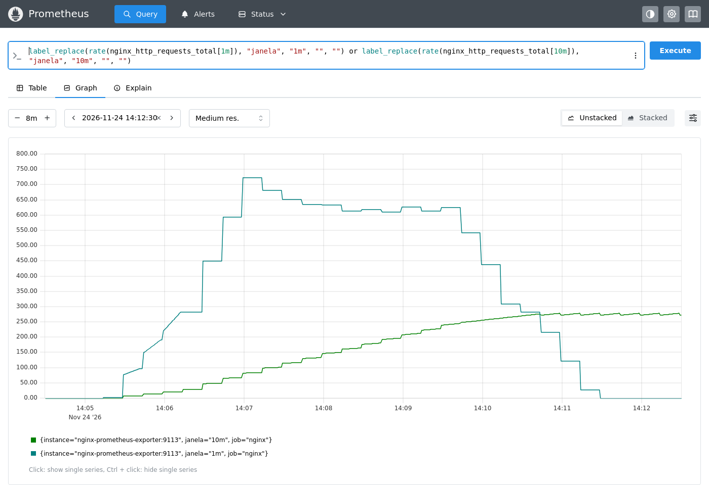

```promql
label_replace(rate(nginx_http_requests_total[1m]), "janela", "1m", "", "")
  or label_replace(rate(nginx_http_requests_total[10m]), "janela", "10m", "", "")
```

A UI do Prometheus mostra uma expressão por painel; para sobrepor as duas
janelas, cada série recebe um label `janela` com `label_replace`, e as duas são
unidas com `or`. A janela de 1 minuto acompanha o pico (subida às 14:06,
máximo de 723 req/s às 14:07, platô de ~620 req/s, queda às 14:10); a de 10
minutos mal reage durante o evento.

### Figura 5.3: p95 da latência por rota, medido na API

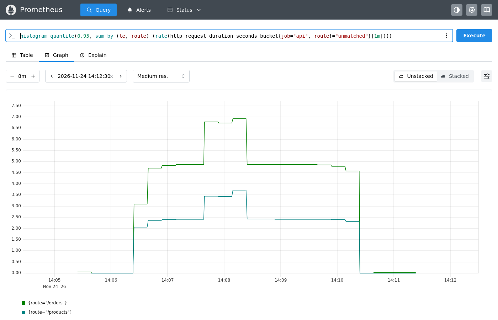

```promql
histogram_quantile(0.95, sum by (le, route) (rate(http_request_duration_seconds_bucket{job="api", route!="unmatched"}[1m])))
```

Em segundos. Antes do pico, poucos milissegundos; durante o pico, ~2,4 s em
`/products` e ~4,9 s em `/orders`, com máximo de 3,7 s e 6,9 s por volta das
14:08. A compra, com duas consultas ao banco, sofre mais.

### Figura 5.4: porcentagem de requisições dentro do SLO (500 ms)

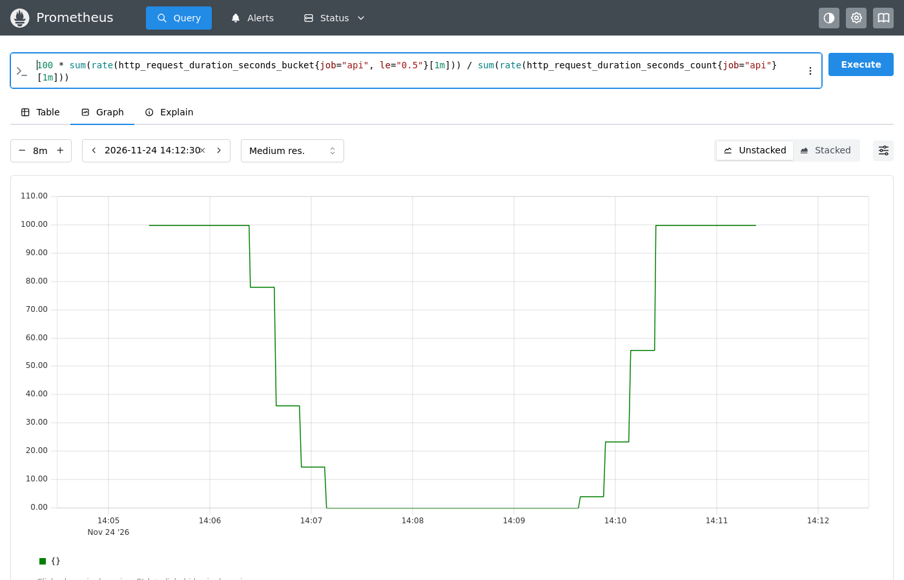

```promql
100 * sum(rate(http_request_duration_seconds_bucket{job="api", le="0.5"}[1m]))
    / sum(rate(http_request_duration_seconds_count{job="api"}[1m]))
```

Cálculo exato graças ao bucket `le="0.5"`. A fração cai de 100 % para 0 % em
cerca de 45 s depois da abertura da promoção e só volta a 100 % às 14:10:25,
depois do fim da corrida.

### Figura 5.5: CPU da réplica

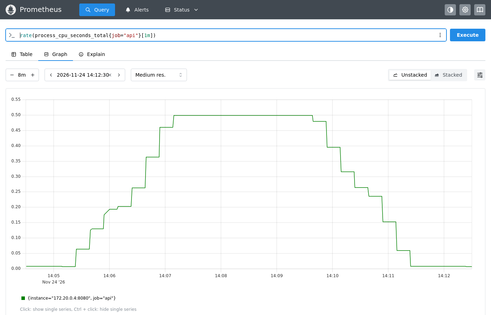

```promql
rate(process_cpu_seconds_total{job="api"}[1m])
```

Em núcleos. A réplica sobe até 0,5 núcleo, o limite do contêiner, e fica
cravada ali das 14:07 às 14:09:40.

### Figura 5.6: CPU da máquina

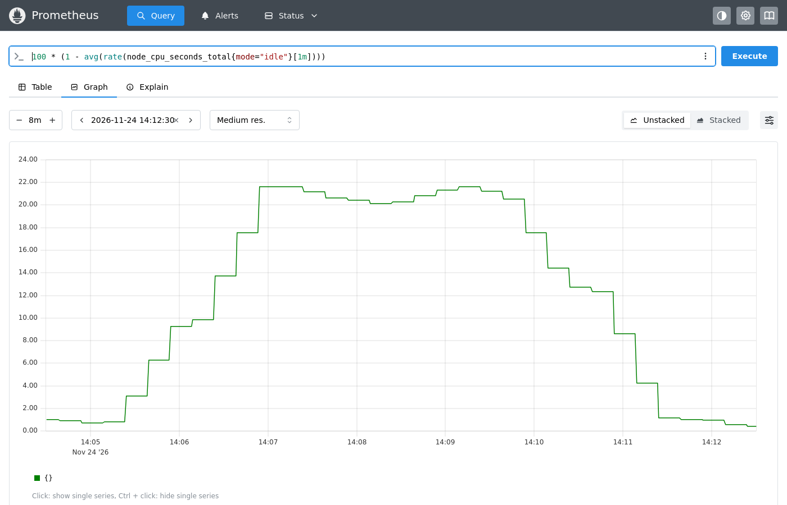

```promql
100 * (1 - avg(rate(node_cpu_seconds_total{mode="idle"}[1m])))
```

Em porcentagem dos 12 núcleos. No mesmo período em que a réplica estava no
limite (Figura 5.5), a máquina não passou de 22 %, valor que inclui o próprio
k6.

### Figuras do k6 (visão do cliente)

Recortes do relatório exportado pelo k6 (`k6/black-friday-1-replica.html`).
**O k6 exibe os horários no fuso local (UTC−4)**: o pico começa às 10:06:12.

#### Figura 5.7: visão geral

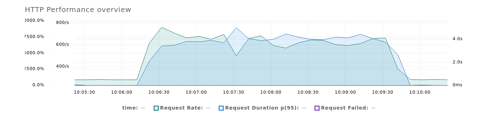

Taxa de requisições (verde, eixo esquerdo) e p95 da duração (azul, eixo
direito). A taxa salta com a abertura da promoção e estabiliza entre 600 e 700
req/s; o p95 sobe junto e fica em torno de 4 s até o fim do pico. A taxa de
falhas (roxo) permanece em zero.

#### Figura 5.8: usuários virtuais e taxa de transferência

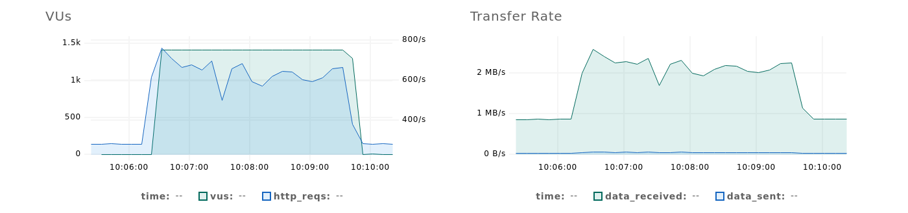

Os VUs saltam para o máximo (1.414) em poucos segundos e ficam presos ali até o
fim do pico: todos esperando resposta. A transferência no pico ficou em ~2 MB/s
(540 MB no total, ~3,3 kB por resposta), muito abaixo da capacidade de qualquer
interface de rede: **a rede não foi o gargalo**.

#### Figura 5.9: duração das requisições

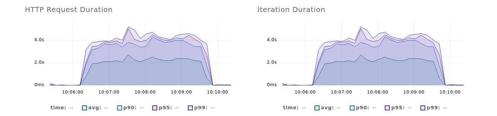

Média, p90, p95 e p99 da duração vista pelo cliente. A média passa de
milissegundos para ~2 s, e o p99 chega a ~5 s.

#### Figura 5.10: taxa de requisições e tempo de espera

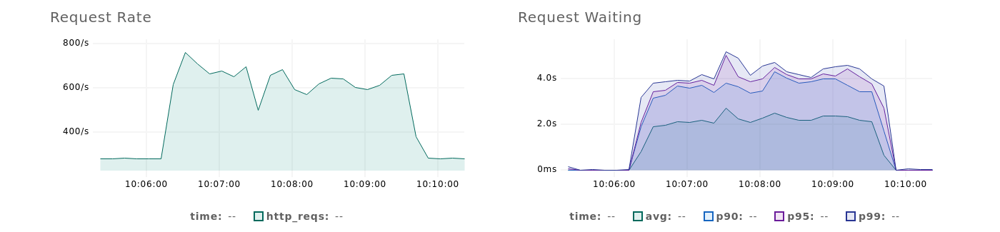

`http_req_waiting` é o tempo entre o fim do envio da requisição e o primeiro
byte da resposta (*time to first byte*). O gráfico é praticamente idêntico ao
da duração total (Figura 5.9).

#### Figura 5.11: tempo de conexão e de recebimento

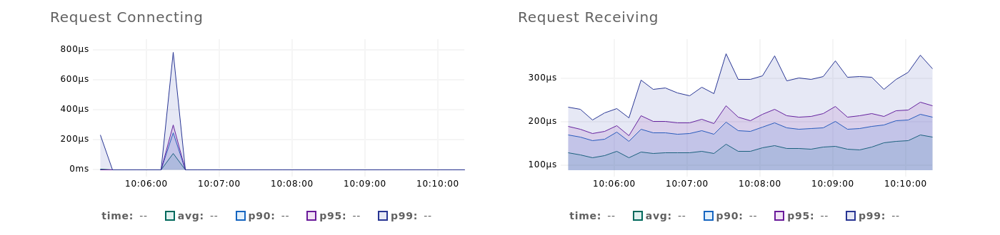

`http_req_connecting` é o tempo do *handshake* TCP. Ele só aparece no instante
em que os VUs novos abrem suas conexões (10:06:20, p99 de ~780 µs) e depois cai
a zero: o k6 reaproveita as conexões (HTTP keep-alive). `http_req_receiving`,
o tempo para receber o corpo da resposta, ficou abaixo de 0,4 ms durante todo
o teste.

#### Figura 5.12: resumo do teste

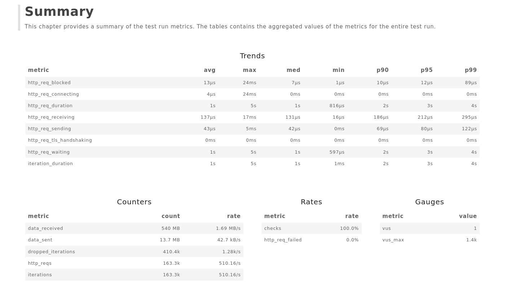

#### Decomposição do tempo de uma requisição

O k6 divide a duração de cada requisição nas fases do protocolo:

| Fase | Métrica do k6 | Média | p95 |
|---|---|---|---|
| espera por uma conexão livre no cliente | `http_req_blocked` | 13 µs | 12 µs |
| *handshake* TCP | `http_req_connecting` | 4 µs | 0 |
| *handshake* TLS | `http_req_tls_handshaking` | 0 (HTTP sem TLS) | 0 |
| envio da requisição | `http_req_sending` | 43 µs | 80 µs |
| **espera pela resposta (TTFB)** | `http_req_waiting` | **1 s** | **3 s** |
| recebimento da resposta | `http_req_receiving` | 137 µs | 212 µs |

Praticamente todo o tempo está na **espera pelo primeiro byte**: a requisição
chegou ao servidor e ficou na fila. As fases de rede (conexão, envio,
recebimento) somam frações de milissegundo. Isso localiza o gargalo do lado do
servidor, e não na rede, e é consistente com a réplica no limite de CPU
(Figura 5.5).

O tempo de espera visto pelo cliente inclui a passagem pelo Nginx e a fila
antes do *event loop* da API; o histograma da API (Figura 5.3) mede apenas o
processamento dentro dela. Os dois têm a mesma ordem de grandeza (segundos)
porque, neste teste, a fila principal ficou **dentro** da API: as conexões
foram aceitas e as requisições disputaram o *event loop* e o pool de conexões
do banco.

### Como as capturas foram feitas

As imagens foram geradas abrindo a URL de cada consulta da UI do Prometheus num
navegador Chromium sem interface (*headless*), por exemplo:

```
http://localhost:9090/query?g0.expr=rate(nginx_http_requests_total[10m])&g0.tab=graph&g0.range_input=8m&g0.end_input=2026-11-24 14:12:30
```

Os dados ficam na TSDB por 15 dias (retenção padrão), então as mesmas
consultas podem ser refeitas na UI até 2026-12-09. As figuras do k6 são
recortes de uma captura de página inteira do relatório HTML exportado.

## 5.7 Efeitos colaterais

As compras do teste inseriram cerca de 21,7 mil pedidos na tabela `orders`.
