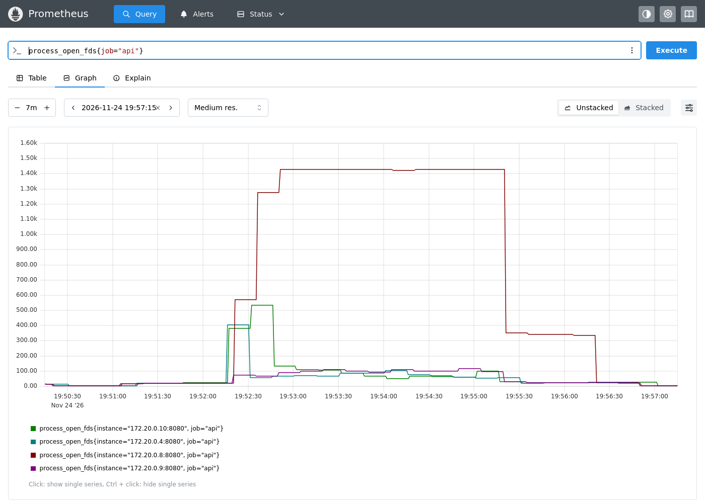
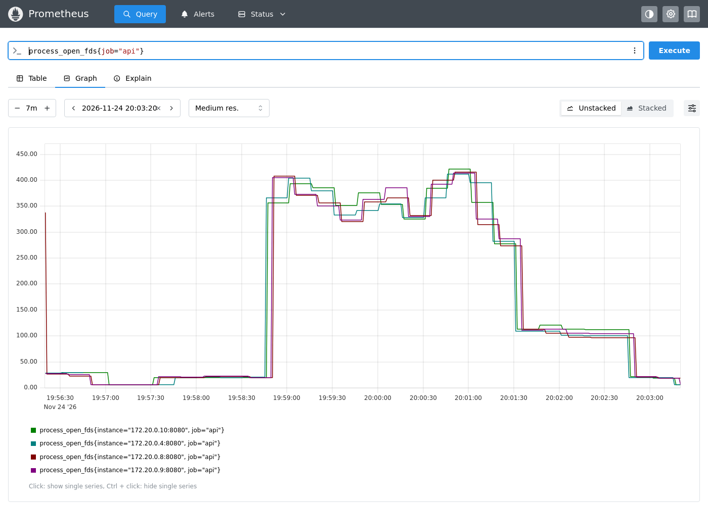
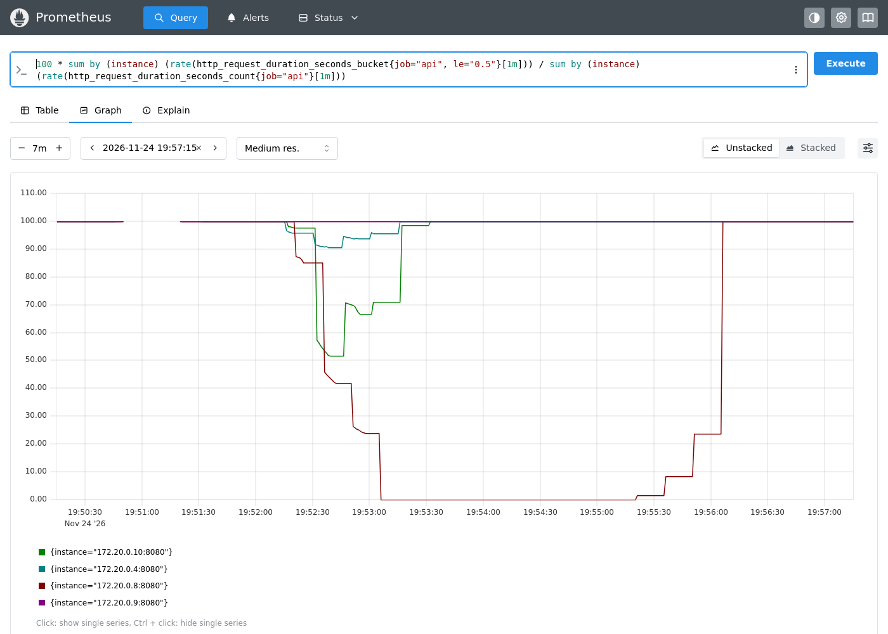
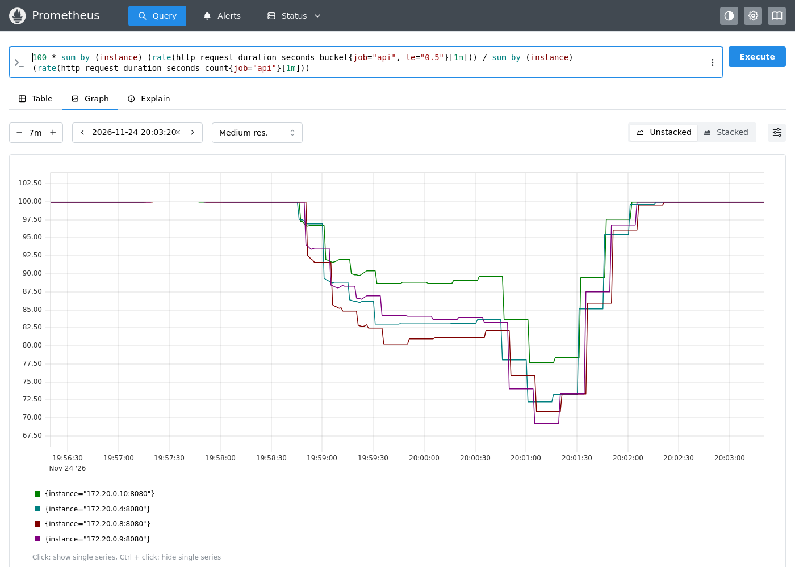
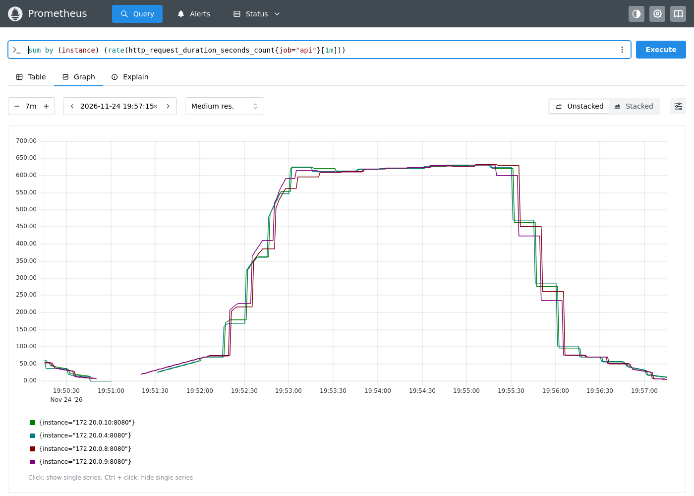
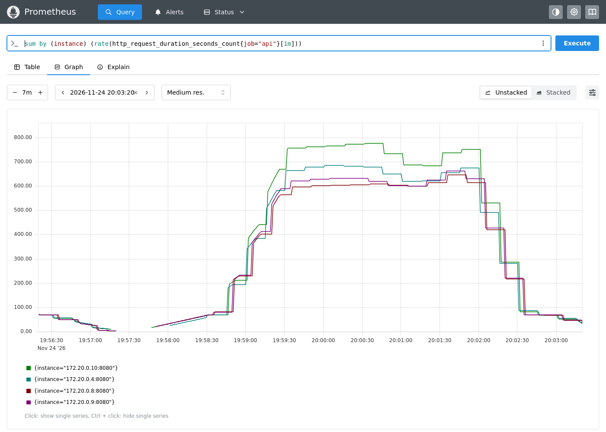
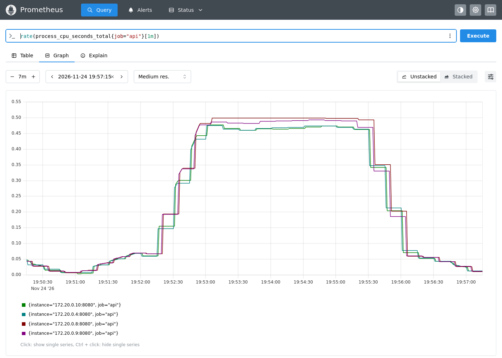
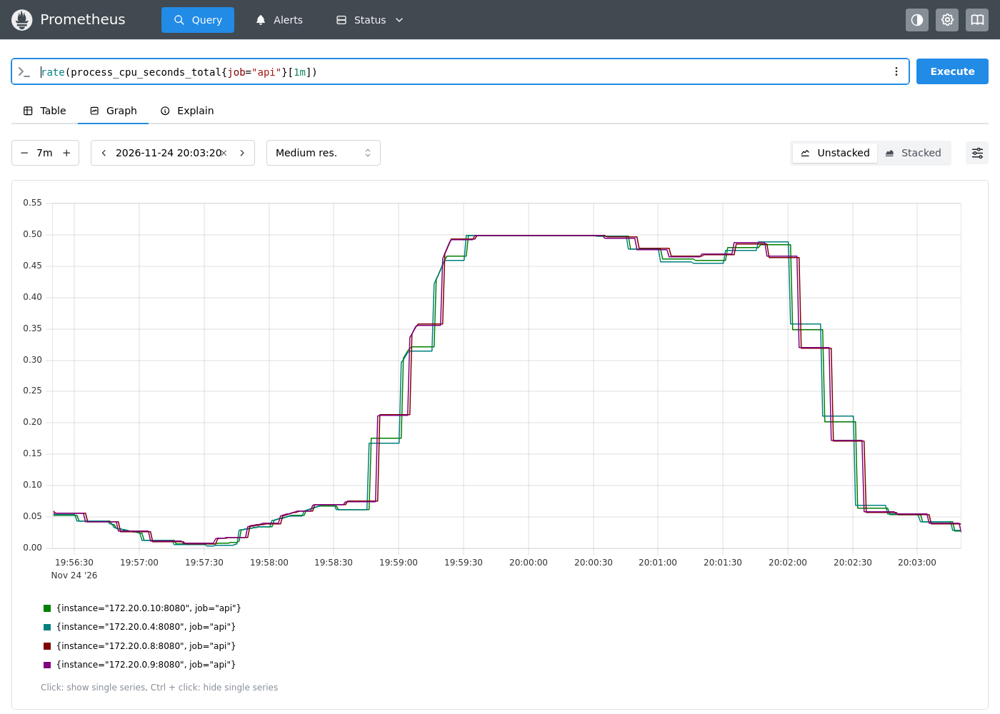
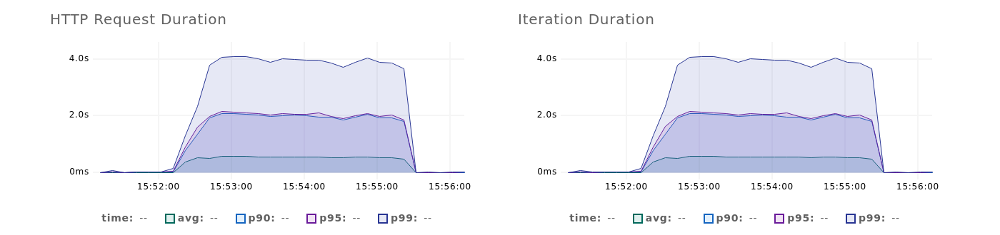
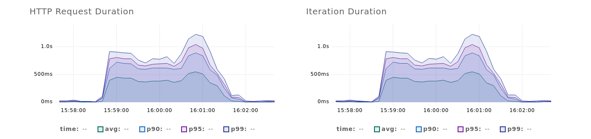

# 6. Escalando para 4 réplicas: round-robin e least_conn

> Rascunho de documentação do processo, para virar seção do artigo.
> Valores: mediana de três execuções [mínimo–máximo]. Ambiente e procedimento na
> seção 8.

## 6.1 Objetivo

Repetir o teste da seção 5 com **4 réplicas** e observar quanto a capacidade
aumenta, como o Nginx distribui a carga e se o método de balanceamento faz
diferença, em **sobrecarga** (pico de 2.826 req/s) e com **folga** (1.413 req/s).

## 6.2 Escalando

```bash
docker compose up -d --scale api=4
```

| Componente | Mecanismo | Resultado |
|---|---|---|
| DNS do Docker | o nome `api` responde com 4 registros A | um IP por réplica |
| Nginx | `server api:8080 resolve` + `resolver ... valid=10s` | réplicas entram no `upstream` sem *reload* |
| Prometheus | `dns_sd_configs` com `refresh_interval: 10s` | 4 alvos no job `api` |

Com round-robin, 400 requisições de teste se dividiram em exatamente 100 por
réplica.

A única diferença entre os cenários de round-robin e `least_conn` é a linha
`least_conn;` no `upstream`.

## 6.3 Resultados em sobrecarga (pico de 2.826 req/s)

| | 1 réplica (seção 5) | 4, round-robin | 4, `least_conn` |
|---|---|---|---|
| Requisições atendidas | 214.743 | 512.960 [509.911–534.316] | 541.939 [520.655–561.143] |
| Visitantes descartados | 358.987 | 60.769 [39.414–63.818] | 31.790 [12.586–53.075] |
| Vazão no platô (req/s) | 919 | 2.494 [2.480–2.637] | 2.648 [2.560–2.783] |
| Dentro do SLO (platô) | 0 % | 75,0 % [57,8–75,0] | 83,3 % [74,4–92,9] |
| Mediana da duração | 1,39 s | **2,1 ms** [1,7–16,9] | 323 ms [237–448] |
| p95 navegação | 1,55 s | 2,03 s [1,03–2,03] | **0,50 s** [0,39–0,58] |
| p95 compra | 3,06 s | 4,00 s [2,04–4,01] | **0,99 s** [0,72–1,10] |
| Duração máxima | 3,59 s | 4,39 s [2,69–4,43] | **1,45 s** [1,11–1,54] |
| CPU da máquina (pico) | 19 % | 50 % [49–51] | 54 % [51–56] |

Erros HTTP: 0 em todas as execuções.

### Por réplica

Cada linha é uma execução. A ordem das réplicas não é a mesma entre as colunas:

| Execução | req/s por réplica | Dentro do SLO por réplica (%) | Descritores abertos (média) |
|---|---|---|---|
| RR 1 | 655, 660, 660, 663 | 0, 100, 100, 31 | 808, 539, 50, 50 |
| RR 2 | 623, 624, 625, 623 | 100, 100, 100, 0 | 105, 1.430, 78, 82 |
| RR 3 | 619, 621, 620, 619 | 100, 0, 100, 100 | 69, 84, 1.433, 85 |
| LC 1 | 659, 723, 745, 660 | 91, 94, 95, 91 | 241, 241, 263, 265 |
| LC 2 | 634, 665, 747, 620 | 82, 82, 87, 81 | 329, 326, 331, 335 |
| LC 3 | 603, 605, 618, 738 | 66, 68, 71, 90 | 404, 404, 410, 417 |

`process_open_fds` conta conexões abertas, incluindo ociosas mantidas por
*keep-alive* (o Nginx reaproveita conexões com a API, seção 2.7). É um **limite
superior** das requisições em andamento: na execução LC 3, a soma passa dos 1.414
VUs do k6.

## 6.4 Resultados com folga (pico de 1.413 req/s)

| | 4, round-robin | 4, `least_conn` |
|---|---|---|
| Requisições atendidas | 305.180 [305.002–305.197] | 305.173 [305.004–305.213] |
| Visitantes descartados | 79 [62–256] | 85 [46–255] |
| Vazão no platô (req/s) | 1.413 | 1.413 |
| Dentro do SLO (platô) | 100 % | 100 % |
| Mediana da duração | 1,3 ms | 1,3 ms |
| p95 navegação | 1,8 ms [1,6–1,8] | 1,6 ms [1,6–1,6] |
| p95 compra | 13,8 ms [12,5–17,8] | 14,9 ms [11,2–18,7] |
| Duração máxima | 254 ms [167–660] | 278 ms [206–316] |
| CPU por réplica | 0,25 a 0,28 | 0,25 a 0,27 |
| CPU da máquina (pico) | 31 % | 30 % |

Os poucos descartes (menos de 0,1 % das requisições) fizeram o limite
`dropped_iterations == 0` do k6 reprovar, embora o SLO tenha sido cumprido.

## 6.5 Análise

### Escalar aumentou a capacidade, sem ser linear

Com 4 réplicas, a vazão no platô foi 2,7 vezes (round-robin) e 2,9 vezes
(`least_conn`) a de uma réplica, e os descartes caíram 83 % e 91 %. Isso é 68 % e
72 % do ideal de 4 vezes. Como a demanda era de 2.826 req/s, a melhor execução
(2.783 req/s) ficou a 2 % dela, e a capacidade máxima pode ser maior que a observada.

No pico, as 4 réplicas usaram 2,0 CPUs (o limite de 4 × 0,5), o PostgreSQL 0,9 a
1,0, o Nginx 0,8 e o k6 1,6 a 1,9. O limite das réplicas e a disputa pelas CPUs
compartilhadas são candidatos para a perda, que não foi isolada.

### Round-robin: réplicas iguais, destinos diferentes

O round-robin entregou **a mesma taxa** a todas as réplicas, e mesmo assim, **nas
três execuções**, pelo menos uma ficou com 0 % das requisições no SLO, enquanto
outras ficaram em 100 %. Não foi sempre a mesma réplica.

A teoria de filas descreve esse comportamento: perto de ρ = 1 (taxa de chegada
igual à de serviço), pequenas diferenças decidem se a fila se esvazia ou cresce. O
round-robin não considera a carga e mantém a fatia da réplica atrasada. O resultado
é **bimodal**: mediana de 2 ms, com p95 de 2 s na navegação e 4 s na compra.

### `least_conn`: espera dividida

Com `least_conn`, as 4 réplicas tiveram números de conexões quase iguais e nenhuma
ficou com 0 % no SLO (de 66 % a 95 %). A espera foi dividida: a mediana subiu para centenas de milissegundos,
e a cauda encolheu.

| Comparação em sobrecarga | Diferença maior que a variação entre execuções? |
|---|---|
| p95, duração máxima: menores com `least_conn` | sim, as faixas não se sobrepõem |
| mediana: menor com round-robin | sim, as faixas não se sobrepõem |
| vazão e descartes: melhores com `least_conn` | não, as faixas se sobrepõem |
| dentro do SLO: maior com `least_conn` | quase: as faixas se tocam (74,4–92,9 e 57,8–75,0) |

O que os dados sustentam é que o `least_conn` **reduz a cauda à custa da mediana**.
Um ganho de vazão ou de SLO é sugerido, mas não demonstrado com três execuções.

### Com folga, o método não fez diferença

A 1,5×, com cada réplica a cerca de metade do limite de CPU, os dois métodos
tiveram 100 % no SLO e latências equivalentes. A escolha do balanceamento só
apareceu perto da saturação.

### O balanceador não cria capacidade

Com a demanda acima da capacidade, o excedente espera em alguma fila, e o método
decide **quem** espera. Para cumprir o SLO é preciso capacidade (mais réplicas,
antes ou durante o pico) ou **controle de admissão**, recusando o excedente (HTTP
429 ou 503).

## 6.6 Figuras

Execuções medianas em requisições atendidas: round-robin 2 (19:51:01–19:56:23 UTC)
e `least_conn` 2 (19:57:30–20:02:52 UTC).

### Figura 6.1: descritores abertos por réplica

Round-robin:



`least_conn`:



### Figura 6.2: requisições dentro do SLO por réplica

Round-robin:



`least_conn`:



### Figura 6.3: requisições por segundo por réplica

Round-robin:



`least_conn`:



### Figura 6.4: CPU por réplica

Round-robin:



`least_conn`:



### Figura 6.5: duração das requisições (k6)

Round-robin:



`least_conn`:



## 6.7 Limitações

As limitações do ambiente estão na seção 8.6. Além delas:

- A mistura de tráfego atendida variou com o método: a execução round-robin 2 teve
  88/12 e a `least_conn` 2 teve 84/16, porque o limite de VUs de compra se esgota
  antes.
- A fração dentro do SLO é medida na API e não inclui o tempo no Nginx nem os
  visitantes descartados.
- **Rodada anterior:** uma execução por método, com o k6 fora dos contêineres,
  indicou 2,6 % no SLO para `least_conn` e 50 % a 72 % para round-robin, o contrário
  desta rodada. Lá a demanda estava bem acima da capacidade observada (1.685 a 2.173
  req/s), e dividir a espera por igual deixou quase todos fora do limite de 0,5 s.
  Nesta rodada, o excesso era menor. Isso sugere, sem provar, que o efeito do
  `least_conn` no SLO depende do tamanho da sobrecarga.
