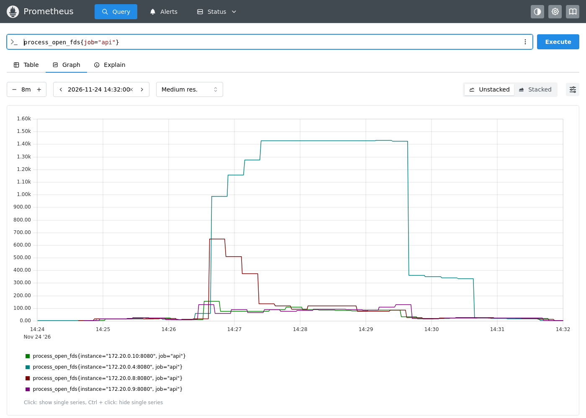
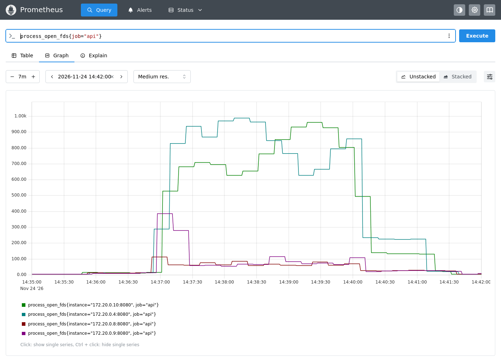
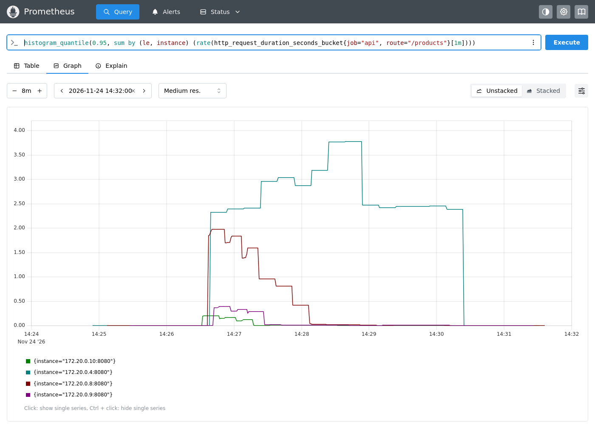
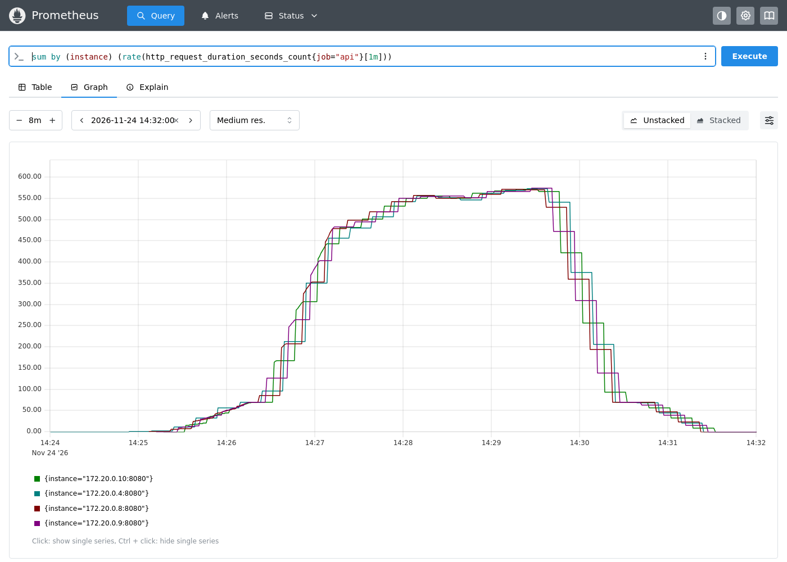
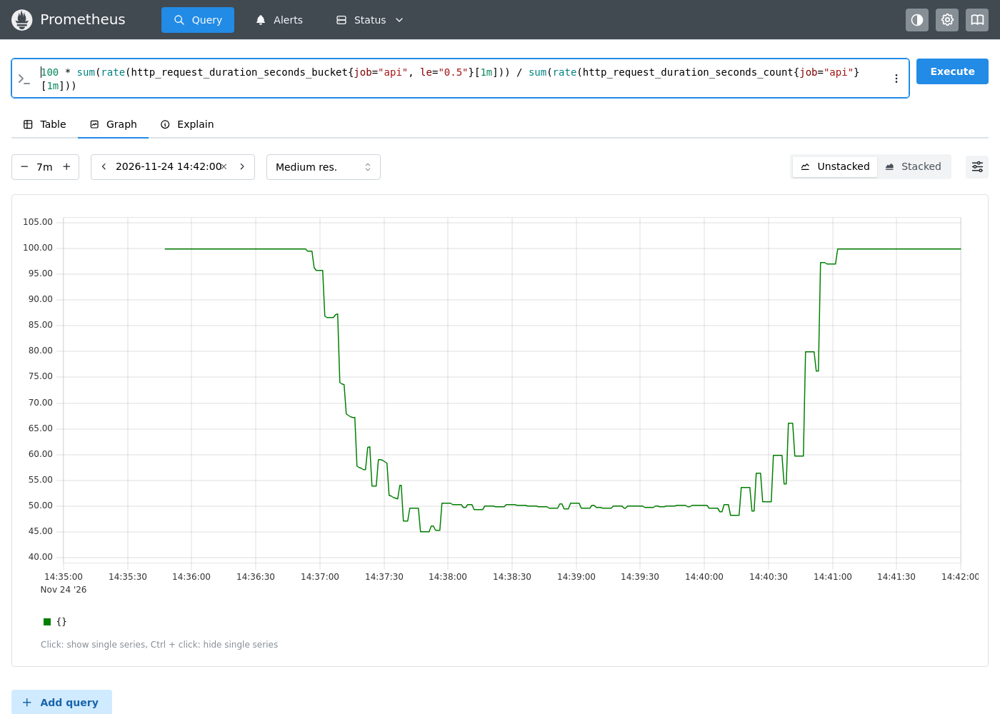
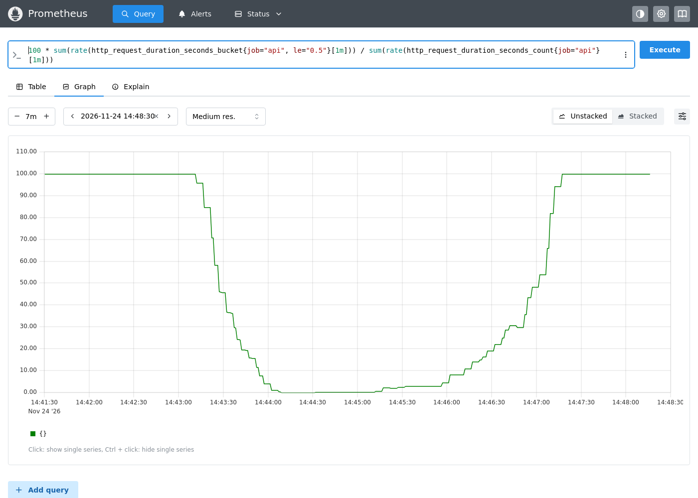
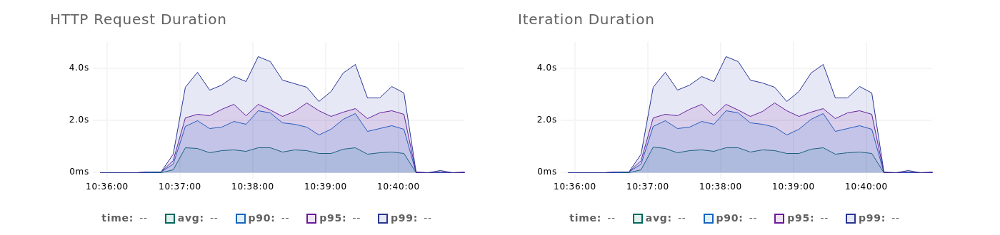
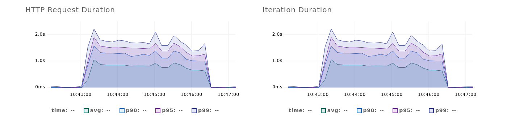

# 6. Escalando para 4 réplicas: round-robin e least_conn

> Rascunho de documentação do processo, para virar seção do artigo.
> Testes executados em 2026-11-24. Horários em UTC (os gráficos do Prometheus
> usam UTC; os do k6, o horário local, UTC−4).

## 6.1 Objetivo

Repetir o teste de Black Friday da seção 5, o mesmo arquivo e a mesma carga
(pico de 2.826 req/s, 3× a capacidade estimada de uma réplica), com a API
escalada para **4 réplicas**, e observar:

1. quanto a capacidade do sistema aumenta;
2. como o Nginx distribui a carga entre as réplicas;
3. se o método de balanceamento faz diferença.

## 6.2 Escalando

```bash
docker compose up -d --scale api=4
```

Nenhuma configuração foi alterada para as réplicas novas serem encontradas:

| Componente | Mecanismo | Resultado |
|---|---|---|
| DNS do Docker | o nome `api` passa a responder com 4 registros A | `172.20.0.4`, `172.20.0.8`, `172.20.0.9`, `172.20.0.10` |
| Nginx | `server api:8080 resolve` + `resolver ... valid=10s` | as 4 réplicas entraram no `upstream` sem *reload* |
| Prometheus | `dns_sd_configs` com `refresh_interval: 10s` | 4 alvos no job `api`, todos UP |

Verificação do balanceamento antes do teste: 400 requisições `GET /products`
pelo Nginx, contadas por réplica com
`sum by (instance) (http_request_duration_seconds_count{route="/products"})`:
**exatamente 100 em cada réplica** (round-robin).

## 6.3 Os testes

Foram feitos três testes com 4 réplicas, mudando uma coisa de cada vez:

| Teste | Balanceamento | Réplicas | Janela (UTC) | Prefixo das figuras |
|---|---|---|---|---|
| A | round-robin | 1 réplica que já tinha passado pelo teste da seção 5 + 3 novas | 14:25:16–14:30:37 | `6a` |
| B | round-robin | 4 réplicas recriadas do zero | 14:35:44–14:41:04 | `6b` |
| C | `least_conn` | 4 réplicas recriadas do zero | 14:42:01–14:47:22 | `6c` |

O teste B existe para separar duas explicações possíveis do resultado do teste
A (seção 6.5). O teste C muda **apenas** o método de balanceamento em relação
ao B.

Mudança no `nginx.conf` para o teste C, uma linha no `upstream`:

```nginx
upstream load_balancer {
    least_conn;
    zone api 64k;
    resolver 127.0.0.11 valid=10s ipv6=off;
    server api:8080 resolve;
}
```

## 6.4 Resultados

Valores do k6 para o teste inteiro; valores do Prometheus como média no platô
do pico (2 min 15 s, a partir de 2 minutos do início).

| | 1 réplica (seção 5) | A: RR, 1 antiga | B: RR, novas | C: `least_conn`, novas |
|---|---|---|---|---|
| Requisições atendidas | 163.289 | **451.059** | 362.043 | 370.858 |
| Visitantes descartados | 410.441 | **122.671** | 211.686 | 202.872 |
| Vazão no platô (Nginx) | 642 req/s | **2.173 req/s** | 1.685 req/s | 1.728 req/s |
| Mediana da duração (k6) | 1,9 s | **7,5 ms** | 55 ms | 709 ms |
| p95 navegação (k6) | 2,36 s | 2,26 s | 1,88 s | **0,97 s** |
| p95 compra (k6) | 4,51 s | 4,48 s | 3,68 s | **1,81 s** |
| Duração máxima (k6) | 5,26 s | 5,49 s | 4,83 s | **2,50 s** |
| Requisições dentro do SLO (platô) | 1,5 % | **71,5 %** | 50,1 % | 2,6 % |
| Réplicas com CPU no limite | 1 de 1 | 1 de 4 | 2 de 4 | **4 de 4** |
| CPU da máquina (pico) | 22 % | 60 % | 56 % | 60 % |

Erros HTTP: 0 % em todos os testes.

### Por réplica, no platô do pico

**Teste A (round-robin, uma réplica antiga):**

| Réplica | req/s | CPU | p50 `/products` | p95 `/products` | Dentro do SLO | Conexões |
|---|---|---|---|---|---|---|
| `.4` (antiga) | 535 | **0,500** | **1,8 s** | **3,8 s** | **0 %** | **1.416** |
| `.8` | 541 | 0,491 | 3,4 ms | 27 ms | 100 % | 135 |
| `.9` | 542 | 0,479 | 2,9 ms | 17 ms | 100 % | 94 |
| `.10` | 532 | 0,474 | 2,9 ms | 16 ms | 100 % | 89 |

**Teste B (round-robin, réplicas novas):**

| Réplica | req/s | CPU | p95 `/products` | Dentro do SLO | Conexões |
|---|---|---|---|---|---|
| `.4` | 419 | **0,500** | **2,4 s** | **0 %** | **837** |
| `.10` | 414 | **0,499** | **2,4 s** | **1,6 %** | **795** |
| `.8` | 419 | 0,477 | 55 ms | 99,8 % | 71 |
| `.9` | 421 | 0,481 | 127 ms | 98,1 % | 79 |

**Teste C (`least_conn`, réplicas novas):**

| Réplica | req/s | CPU | p95 `/products` | Dentro do SLO | Conexões |
|---|---|---|---|---|---|
| `.4` | 392 | 0,500 | 1,08 s | 0,3 % | 456 |
| `.8` | 384 | 0,500 | 1,24 s | 0,5 % | 452 |
| `.9` | 456 | 0,500 | 0,98 s | 3,7 % | 451 |
| `.10` | 472 | 0,497 | 0,97 s | 5,3 % | 444 |

"Conexões" é `process_open_fds`: cada conexão aberta pelo Nginx com a réplica
ocupa um descritor, então o valor acompanha o número de requisições em
andamento naquela réplica.

## 6.5 Análise

### Escalar aumentou a capacidade

Com 4 réplicas, o sistema atendeu de 2,2 a 2,8 vezes mais requisições, e a
vazão no pico foi de 2,6 a 3,4 vezes a de uma réplica. Os visitantes
descartados caíram de 410 mil para 123–212 mil. Mesmo assim, **nenhum teste
cumpriu o SLO**: a demanda do pico (2.826 req/s) continuou acima da capacidade
de 4 réplicas nesta máquina (1.700–2.200 req/s).

### O crescimento não foi linear

Uma réplica sozinha sustentou ~640 req/s; com 4, cada uma sustentou ~380–540
req/s. Hipóteses para a perda de eficiência, não isoladas nestes testes:

- **CPU da máquina compartilhada.** A CPU total subiu de 22 % para ~60 %: as
  réplicas, o PostgreSQL, o Nginx e o próprio k6, que precisa gerar mais de
  2.000 req/s, disputam os mesmos 12 núcleos.
- **Banco único.** O PostgreSQL passou a receber até 40 conexões (4 réplicas ×
  10 do pool) em vez de 10.
- **Variação entre execuções.** Os testes A e B têm a mesma configuração de
  balanceamento, mas vazões diferentes (2.173 e 1.685 req/s).

É o comportamento previsto para recursos compartilhados: escalar a camada da
aplicação não escala o que ela usa por baixo.

### Round-robin: réplicas iguais, destinos diferentes

No teste A, o round-robin mandou **a mesma taxa** para as 4 réplicas (~535
req/s cada). Três ficaram logo abaixo do limite de CPU e responderam em
milissegundos; uma, a `.4`, ficou cravada em 0,500 núcleo e acumulou 1.416
requisições em andamento. Pela lei de Little, 535 req/s × ~2,6 s ≈ 1.400. Ela
continuou drenando a fila por cerca de 1 minuto **depois** do fim do teste
(Figura 6a.6).

A primeira explicação seria a `.4` ser diferente: era a única que já tinha
rodado o teste da seção 5. O **teste B** descartou essa hipótese: com as 4
réplicas recriadas do zero, o mesmo fenômeno aconteceu, desta vez com **duas**
réplicas (`.4` e `.10`) saturadas e duas saudáveis. Além disso, no teste A, a
`.8` também formou fila no início do pico (~650 conexões) e conseguiu se
recuperar (Figura 6a.6): as réplicas partiram da mesma situação, e algumas
escaparam e outras não.

A explicação está na **teoria de filas**. Com utilização ρ = taxa de chegada ÷
taxa de serviço:

- se ρ < 1, a réplica atende mais rápido do que as requisições chegam, e a
  fila se esvazia;
- se ρ > 1, a fila cresce sem limite enquanto a carga durar.

Perto de ρ = 1, diferenças pequenas (uma rajada a mais no início do pico, uma
pausa da coleta de lixo, a disputa por CPU com os outros processos) decidem de
que lado cada réplica fica. Como o round-robin **não considera a carga** de
cada réplica, ele continua mandando a mesma fatia para a réplica atolada, e ela
nunca sai do buraco. O resultado é uma experiência **bimodal**: no teste B,
metade das requisições dentro do SLO e metade com segundos de espera.

### least_conn: a fila dividida por igual

O `least_conn` envia cada requisição para a réplica com **menos conexões
ativas**. No teste C, as conexões em andamento ficaram praticamente iguais nas
4 réplicas (444–456, Figura 6c.6), contra 71–837 no teste B (Figura 6b.6), e
as 4 réplicas trabalharam no limite de CPU.

O efeito sobre a latência foi o oposto do round-robin:

| | B: round-robin | C: `least_conn` |
|---|---|---|
| Mediana | 55 ms | 709 ms |
| p95 navegação | 1,88 s | 0,97 s |
| Máximo | 4,83 s | 2,50 s |
| Dentro do SLO | 50 % | 2,6 % |
| Vazão | 1.685 req/s | 1.728 req/s |

O `least_conn` **eliminou a cauda**: o pior caso caiu pela metade, e a latência
ficou uniforme entre as réplicas. Em compensação, **todos** passaram a esperar
cerca de 1 segundo, e quase ninguém ficou dentro do SLO. A vazão praticamente
não mudou.

### O balanceador não cria capacidade

A conclusão comum aos três testes: com a demanda (2.826 req/s) acima da
capacidade (~1.700 req/s), o excedente **precisa** esperar em alguma fila. O
método de balanceamento só decide **quem espera**:

- **round-robin:** parte das réplicas fica livre e parte acumula toda a fila.
  Muitos clientes são atendidos rápido; os que caem na réplica saturada esperam
  segundos;
- **`least_conn`:** a fila é dividida igualmente. Ninguém espera muito, mas
  todos esperam.

Para cumprir o SLO, é preciso **capacidade**: mais réplicas antes do pico
(escalonamento antecipado), mais réplicas durante o pico (escalonamento
reativo, como o KEDA), ou **controle de admissão**: recusar rapidamente o
excedente (HTTP 429 ou 503) para proteger quem já está sendo atendido. O
`least_conn` continua sendo a escolha mais adequada para requisições de duração
variável, como nesta loja, e foi mantido na configuração.

## 6.6 As camadas continuam concordando

Teste A, contagem no período do teste:

| Fonte | Requisições |
|---|---|
| k6 (`http_reqs`) | 451.059 |
| Nginx (diferença do contador `nginx_http_requests_total`) | 451.083 |
| API (soma de `http_request_duration_seconds_count` das 4 réplicas) | 451.059 |

A diferença de 24 no Nginx são as coletas do próprio exporter. A soma das 4
réplicas bate exatamente com o k6.

## 6.7 Figuras

Todas as figuras do Prometheus estão em `docs/img/`, com 8 consultas por teste.
Para comparar os testes, use o mesmo número de figura com prefixos diferentes
(`6a`, `6b`, `6c`).

| Nº | Arquivo (sufixo) | Consulta |
|---|---|---|
| 1 | `rate-1m-vs-10m` | `label_replace(rate(nginx_http_requests_total[1m]), "janela", "1m", "", "") or label_replace(rate(nginx_http_requests_total[10m]), "janela", "10m", "", "")` |
| 2 | `reqs-por-replica` | `sum by (instance) (rate(http_request_duration_seconds_count{job="api"}[1m]))` |
| 3 | `cpu-por-replica` | `rate(process_cpu_seconds_total{job="api"}[1m])` |
| 4 | `p95-por-replica` | `histogram_quantile(0.95, sum by (le, instance) (rate(http_request_duration_seconds_bucket{job="api", route="/products"}[1m])))` |
| 5 | `slo-por-replica` | `100 * sum by (instance) (rate(http_request_duration_seconds_bucket{job="api", le="0.5"}[1m])) / sum by (instance) (rate(http_request_duration_seconds_count{job="api"}[1m]))` |
| 6 | `conexoes-por-replica` | `process_open_fds{job="api"}` |
| 7 | `slo-total` | `100 * sum(rate(http_request_duration_seconds_bucket{job="api", le="0.5"}[1m])) / sum(rate(http_request_duration_seconds_count{job="api"}[1m]))` |
| 8 | `cpu-maquina` | `100 * (1 - avg(rate(node_cpu_seconds_total{mode="idle"}[1m])))` |

### As figuras principais

#### Figura 6a.6: conexões por réplica, round-robin com uma réplica antiga



A `.4` acumula ~1.430 conexões e só as drena depois do fim do teste; a `.8`
forma fila no início do pico e se recupera.

#### Figura 6b.6: conexões por réplica, round-robin com réplicas novas



Duas réplicas saturam (~800–990 conexões), duas ficam abaixo de 120.

#### Figura 6c.6: conexões por réplica, least_conn


As 4 réplicas com ~450 conexões cada: a fila dividida por igual.

#### Figura 6a.4: p95 de `/products` por réplica, teste A



Em segundos. A `.4` chega a 3,8 s; a `.8` sobe a 2 s no início e se recupera;
as outras ficam perto de zero.

#### Figura 6a.2: requisições por segundo por réplica, teste A



As 4 linhas praticamente sobrepostas: o round-robin entregou a mesma taxa a
todas, inclusive à réplica saturada.

#### Figura 6b.7 e 6c.7: requisições dentro do SLO





Round-robin (B) estabiliza em ~50 %; `least_conn` (C) cai para perto de zero.

#### Figuras do k6: duração das requisições, testes B e C





Com round-robin (B), a média fica perto de 1 s e o p99 chega a ~4,4 s: a
distância entre média e cauda é grande. Com `least_conn` (C), média e p99
ficam próximos (1 s e ~2 s): todos esperam parecido.

Os relatórios completos do k6, como imagem de página inteira, estão em
`docs/img/k6-relatorio-6a.png` (A), `docs/img/k6-relatorio-6b.png` (B) e
`docs/img/k6-relatorio-6c.png` (C), com recortes em
`docs/img/fig-6{a,b,c}-k6-*.png`.

## 6.8 Limitações

- **Gerador de carga na mesma máquina.** O k6 roda no mesmo computador e
  disputa CPU com o sistema testado; com 4 réplicas, a CPU total chegou a 60 %.
- **Caminho de rede do gerador.** O k6 acessa o sistema pela porta publicada
  do Docker Desktop (`localhost:80`), que passa por um encaminhamento de portas
  do próprio Docker antes de chegar ao Nginx. Esse salto não aparece em nenhuma
  métrica coletada. Rodar o k6 num contêiner na rede do Compose eliminaria
  esse salto.
- **Uma execução por configuração.** A diferença de vazão entre os testes A e B
  (mesma configuração de balanceamento) mostra que há variação entre execuções;
  repetir cada teste algumas vezes daria margens de erro.
- **Artefato de medição.** No teste A, o k6 reportou duração mínima negativa
  (−606 µs), um erro de medição do relógio do gerador sob carga; não afeta os
  percentis.
